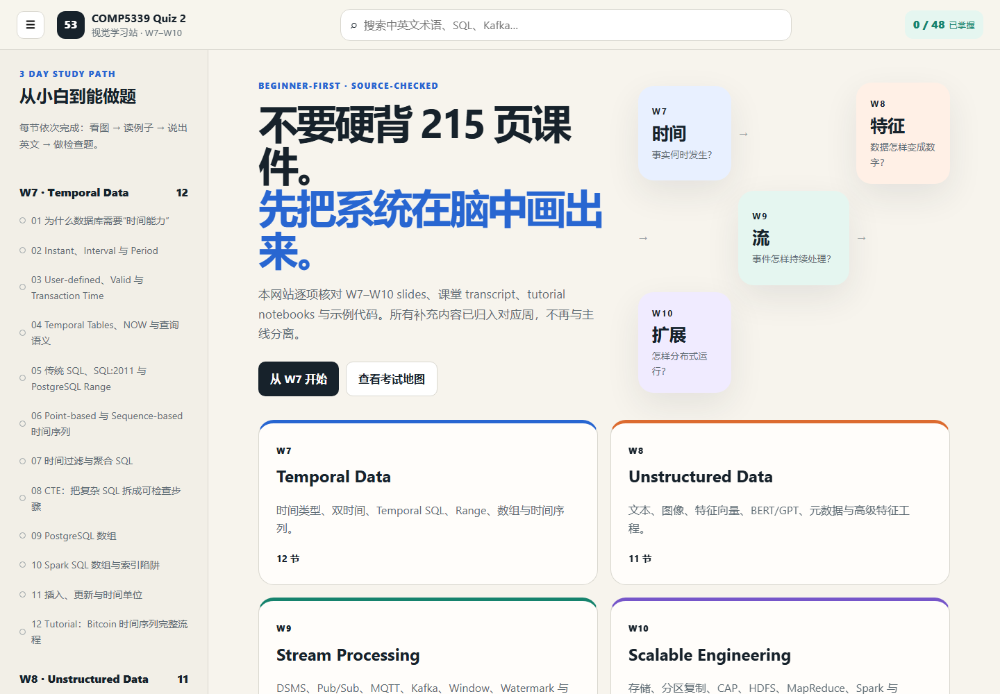

# COMP5339 Quiz 2 Visual Study Guide

[Live demo](https://comp5339-quiz2-visual-study.tenderdaisy128.chatgpt.site/) · [Project record](PROJECT_RECORD.md) · [Source coverage](SOURCE_COVERAGE.md)

[48 项完整叙事总表](https://comp5339-quiz2-visual-study.tenderdaisy128.chatgpt.site/exam-table)

[W7–W10 全术语词典](https://comp5339-quiz2-visual-study.tenderdaisy128.chatgpt.site/glossary)

这是一个面向零基础学习者的交互式复习网站。项目起因是：只有大段文字的复习资料难以持续阅读和记忆，因此把 COMP5339 Week 7–10 的知识整理成可搜索、可视化、可自测的网页。



## 可核验成果

- 覆盖 W7–W10，共 **48 个主题单元**。
- 新增按周组织的 **48 项完整叙事总表**，逐项给出“名称—概念—关系—例子”，并附英文题干触发词、代码/公式和易错点；支持周次筛选、搜索、手机阅读和打印为 PDF。
- 逐页复核 W7–W10 讲义术语，建立 **281 项全术语词典**：W7 55、W8 75、W9 64、W10 87。每个专业名词均独立提供中文含义、定义、实际作用、与相似概念的关系和具体例子。
- 提供 **2 个考试工具**：高频概念对比与中英文术语速查。
- 每个主题包含目标、图解或对照表、正文说明和即时自测；全站共有 **71 道检查题**。
- 新增多模式复习工作台：Summary、完整 Notes、Mind Map、48 张 Flashcards 和按周 Quiz；答错题目可单独重练。
- 48 个课程单元末尾均有“考场速查”：题干触发词、直接结论、必背规则、代码/公式和常见陷阱；完整答案可展开或收起。
- 提供两份可打印的 A4 横向双面 PDF：Quiz 2（W7–W10）与期末（W1–W10），均已验证为严格 2 页。
- 按 W7–W10 slides、lecture transcript 与 tutorial code 建立逐页覆盖表，并为 27 个容易遗漏的主题补充深度讲解。
- 支持全文搜索、周次筛选、上一节/下一节导航和本地学习进度。
- 网站使用原生 HTML、CSS 和 JavaScript，无需前端构建工具或第三方运行依赖。
- W10 的 Bitcoin 图表来自实际 notebook 运行结果，并在网页中明确标注来源性质。

## 我如何使用 AI

这是一个 AI 辅助完成、由人持续提出要求并核验结果的项目。人工工作包括定义学习问题、要求覆盖全部 W7–W10 材料、指出内容遗漏、要求增加图表与流程、检查英文术语和实际运行结果，并反复验收网页。AI 用于材料归纳、知识结构设计、页面实现、交互代码生成、内容一致性检查和浏览器测试。

项目没有把“使用 AI”包装成独立手写全部代码。它展示的是如何把一个模糊需求逐步拆成可验证的产品：从文字版资料，到按周组织的 48 节内容，再到搜索、进度、自测、响应式布局和公开部署。

## 运行方式

下载仓库分支后，在本目录运行：

```powershell
python -m http.server 8130
```

然后访问 `http://127.0.0.1:8130/`。直接双击 `index.html` 通常也能打开，但本地 HTTP 服务更接近实际部署环境。

## 文件结构

```text
.
├── index.html              # 页面结构
├── styles.css              # 响应式视觉样式
├── app.js                  # 搜索、导航、测验与进度逻辑
├── content.js              # W7–W10 结构化学习内容
├── study.html              # 多模式复习工作台
├── study.css               # 工作台响应式视觉样式
├── study.js                # 周总结、闪卡、测验和错题重练
├── study-data.js           # 由同一课程来源生成的学习数据
├── exam-table.html         # W7–W10 名称—概念—关系—例子总表
├── exam-table.css          # 总表桌面、手机和打印样式
├── exam-table.js           # 总表搜索、筛选和打印逻辑
├── exam-table-data.js      # 48 项结构化叙事复习数据
├── glossary.html           # 281 项逐术语完整解释表
├── glossary.css            # 术语词典桌面、手机和打印样式
├── glossary.js             # 全文搜索与周次筛选
├── glossary-data.js        # 含义、作用、关系、例子的结构化术语数据
├── assets/                 # 图表、运行截图与两份双面 A4 cheatsheet
├── tools/                  # 考场速查卡和 PDF 的可复现生成脚本
├── requirements.txt        # PDF 生成依赖
├── site-preview.png        # 网站预览
├── bitcoin-july-plot.png   # 实际代码运行图表
├── PROJECT_RECORD.md       # 目标、过程、分工边界与验证记录
├── SOURCE_COVERAGE.md      # 来源覆盖与公开范围说明
└── project-manifest.json   # 可核验指标、公开文件与 AI 边界
```

## 公开范围

仓库只包含原创网页代码、重写后的学习说明和可公开展示的生成结果。课程 PDF、录屏、transcript、notebook、原始数据、账号凭据、本地运行环境和部署配置均未上传。此网站是个人学习辅助材料，不是悉尼大学官方教学资源。

